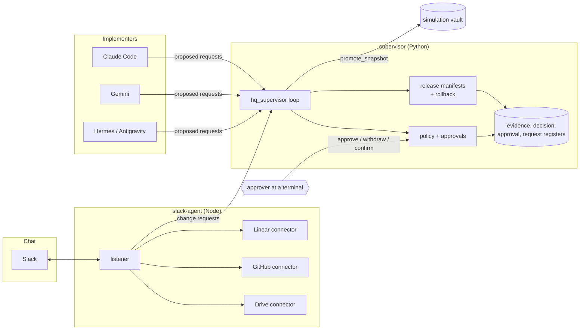

# Engineering HQ

This is the framework my co-founder and I ran our engineering through while working remotely. AI coding agents do the implementation, and this layer keeps them accountable. The agents propose; a policy decides what they may do on their own. Anything that ships, spends, deletes or changes permissions waits for one of us to approve it at a terminal. Every result, decision and approval lands in an append-only, hash-chained register. The product it managed is private. This repo is the framework, rebuilt with example data from a fictional team, Acme Widgets, shipping fictional thermostat firmware.

## Architecture



The connectors only read. The slack-agent can file a request, but it cannot approve one, and neither can any implementer. Approvals come from a person at a terminal with their own token. More detail, and the reasoning behind each choice, is in [ARCHITECTURE.md](ARCHITECTURE.md).

## How a request flows

1. **An agent proposes.** An implementer, or the slack-agent on someone's behalf, drops a request into the supervisor's inbox: an id, an action, a role and a payload. A request names things (a check, a version); it never carries a command line.
2. **The policy classifies it.**
   - *Routine*: runs.
   - *Prepare-only*: produces a draft and nothing else.
   - *Forbidden*: refused outright.
   - *Protected*: waits. An action nobody classified is treated as protected.
3. **A protected request waits for an approver.** At a terminal, the approver enters their own token (hidden) and reads the request. They type its id back and state a budget, a call limit and an expiry. The approval row is bound to the SHA-256 of that exact request.
4. **Evidence row.** Each check or release records what was measured: the result, and the SHA-256 of every artifact.
5. **Decision row.** A decision cites current evidence and names its document by hash. It is adopted only when every required approver has confirmed that same hash.
6. **Manifest, then release.** The supervisor stages the release into a hash-pinned manifest, verifies it, switches `CURRENT`, and records the activation.
7. **Rollback.** Rolling back is itself a protected request. It verifies the previous release against its manifest before switching back, and refuses if anything changed.

The approval flow in detail is in [APPROVALS.md](APPROVALS.md).

## Quickstart

Python 3.12+ and Node 20+. No tokens and no network are needed for any of this.

```bash
pip install -r supervisor/requirements-dev.txt
python -m pytest supervisor/tests -q          # policy, registers, manifests, rollback, vault, schemas
cd slack-agent && npm ci && npm test && cd ..  # listener and connectors, against the fake connector
```

Run the whole flow against the example team:

```bash
# 1. give the supervisor some work
mkdir -p examples/acme/state/inbox
cp examples/acme/requests/*.json examples/acme/state/inbox/
python supervisor/hq_supervisor.py --config examples/acme/config.yaml run --once
python supervisor/hq_supervisor.py --config examples/acme/config.yaml status

# 2. approve the 1.4.0 release (demo token for the owner role: acme-demo-owner)
python supervisor/hq_supervisor.py --config examples/acme/config.yaml approve REQ-acme-002 --as owner --usd 2 --calls 3
python supervisor/hq_supervisor.py --config examples/acme/config.yaml run --once

# 3. everything still verifies
python supervisor/hq_supervisor.py --config examples/acme/config.yaml verify
```

Talk to the slack-agent in a terminal, with fake connectors:

```bash
cd slack-agent && npm start
you> ACME-15
you> search night setback
you> merge acme/thermostat-firmware#7     # files a request for the supervisor; it never merges
```

To run it continuously, `python supervisor/hq_supervisor.py --config examples/acme/config.yaml run` starts the loop and the read-only status page at `http://127.0.0.1:8765/api/requests`. On Windows, `scripts/start.ps1`, `stop.ps1`, `backup.ps1` and `check.py` wrap this. [docs/interview-walkthrough.md](docs/interview-walkthrough.md) is a ten-minute guided demo.

Real installs start from `supervisor/config.example.yaml` and `.env.example`. Both programs refuse to start while a required value is missing or still a placeholder, and the published demo tokens only work in a config marked `demo: true`.

## Design decisions I'd defend in an interview

- **Unclassified means protected.** When an agent gains a new capability, it waits for a person until someone decides otherwise. The failure mode is a delay, not an unreviewed action.
- **Approvals happen at a terminal, never in chat or on a web page.** A click on an unauthenticated local page, or a message in Slack, can't prove who sent it. So the approver types their own token, and the request id back, into a console.
- **An approval is a row bound to the exact request.** It has a budget, a call limit and an expiry, and it binds to the request's SHA-256. If the request changes, the approval stops matching. A withdrawal is another row; nothing is edited.
- **Evidence before decisions.** A decision has to cite evidence whose artifacts still hash to what was recorded. Stale or changed evidence blocks the decision instead of quietly supporting it.
- **Manifests are reproducible and rollback verifies first.** No timestamps in the hashed part, so the same files always give the same manifest. A rollback target that no longer matches its manifest is refused rather than restored.
- **Connectors are read-only in code, not just by token scope.** Every live connector goes through one helper that refuses anything but GET (and GraphQL queries for Linear). That's belt and braces if a token turns out to be over-scoped.

## What's not here

- **The product content.** The registers, decisions, evidence, release history and documents belong to the product, and they stay private.
- **Names and specifics.** Every person, agent persona, ticket, path, host and company detail was removed. The agents appear only as roles (`orchestrator`, `slack-agent`, `implementer`, `approver`), and every example is fictional.
- **The original service layer.** It ran as an HTTP gateway with a database. Here the same rules live in a Python library and CLI that can be read in one sitting.

All rights reserved ([LICENSE](LICENSE)): published for portfolio review only, not for reuse. I'm Levi Stoddard: [linkedin.com/in/levi-stoddard](https://www.linkedin.com/in/levi-stoddard).
